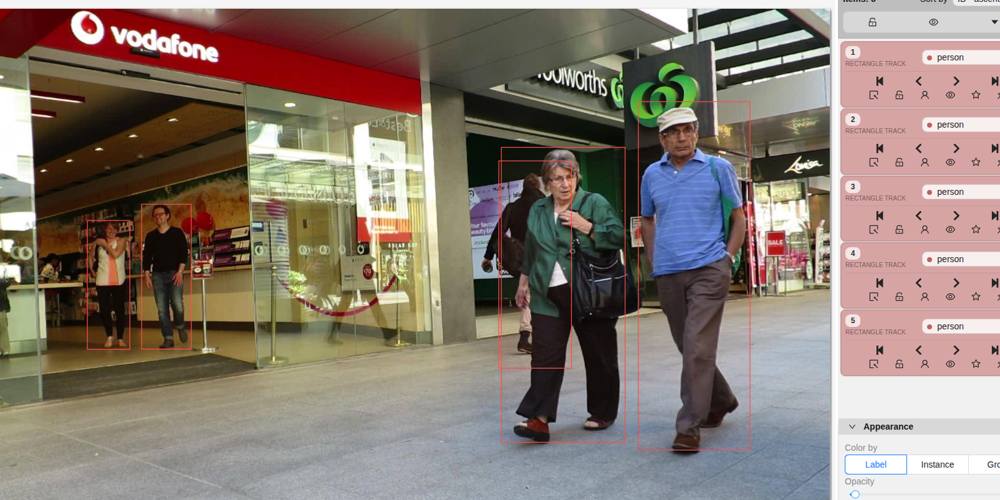
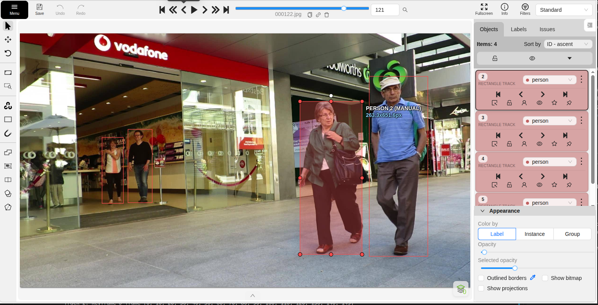
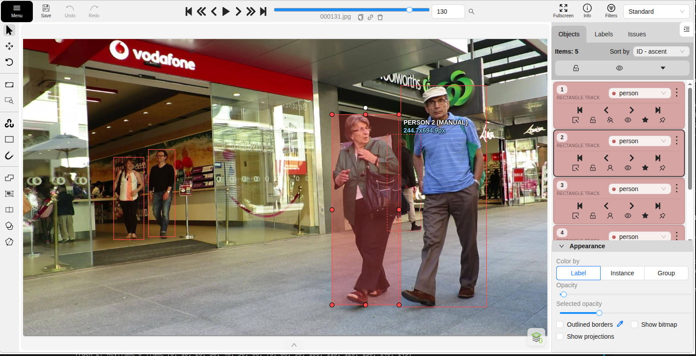

# Báo cáo cá nhân — HoVaTen-MSSV

Đổi tên file theo quy tắc `MSSV_HoTen.md`. Ví dụ: `20241234_NguyenVanAn.md`.

Đoạn video: MOT17-09, 150 frame (frame 1–150), nguồn MOTChallenge, giấy phép CC BY-NC-SA 3.0.

## 0. Thông tin học viên

- Họ tên: Nguyễn Thái Đức 
- MSSV: 2A202603293
- Mã đề (A/B/C): A
- Email: nguyenthaiduc01022004@gmail.com
- Link repository: https://github.com/Theduckyman124/K5-L2-DAY05-NguyenThaiDuc-2A202603293-MOTTracking
- Giờ bắt đầu: 16:00 13/11 /2026
- Giờ kết thúc:18:00 13/11/2026

## 1. Xem trước đoạn video (CP0)

Ghi **trước khi vẽ**, mỗi người một dòng.

| Mã | Frame xuất hiện | Frame cuối thấy được | Rẽ / dừng / đổi tốc độ ở frame | Bị che ở frame | Ghi chú |
|---|---|---|---|---|---|
| P1 | 0 | 138| không đổi tốc độ đáng kể qua mắt thường| 120 | |
| P2 | 0 | 149 | không đổi tốc độ đáng kể qua mắt thường | | |
| P3 | 0 | 149 | không đổi tốc độ đáng kể qua mắt thường | | |
| P4 | 60 | 149 | không đổi tốc độ đáng kể qua mắt thường | |
| P5 | 70 | 149 | không đổi tốc độ đáng kể qua mắt thường | | |

## 2. Keyframe và thời gian (CP1, CP4)

Số keyframe lấy từ kết quả `src/check_submission.py`.

| Mã | Số keyframe | Keyframe ở frame | Số frame có mặt | Keyframe / 100 frame | Thời gian (giây) | Chỗ khó |
|---|---|---|---|---|---|---|
| P1 | 13| |128 |10.2 | | |
| P2 | 16| | 150|10.7 | | |
| P3 | 16| | 150|10.7 | | |
| P4 | 10| | 90| 11.1| | |
| P5 | 9| | 80|11.2 | | |
| **Tổng** |64 |598 | | | | |

Keyframe / 100 frame của cả bài = tổng keyframe ÷ tổng số frame có mặt × 100 = 

...

## 3. Đoạn bị che (CP2)

Người bị che: `P1`

| Mốc | Frame |
|---|---:|
| Bắt đầu bị che một phần (bật `occluded`) | 110|
| Mất hẳn (bật `outside`) | 120 |
| Hiện lại (tắt `outside`) | 130 |
| Thấy rõ trở lại (tắt `occluded`) | không thấy rõ trở lại, bị che ở những frame cuối |

- Thời gian khuất hẳn: 120 frame = 4 giây.
- Quyết định: giữ cùng ID
- Lý do (trả lời 3 câu: khuất bao lâu so với 60 frame, ngoại hình có khớp, chỗ hiện lại có đúng hướng và tốc độ):
Đối tượng khuất hẳn từ frame 120 đến frame 130, tương đương 10 frame (khoảng 0,33 giây ở 30 FPS), ngắn hơn nhiều so với ngưỡng 60 frame.Nếu đối tượng xuất hiện lại có ngoại hình, kích thước và đặc điểm nhận dạng trùng khớp với trước khi bị khuất thì có cơ sở xác định đây là cùng một đối tượng. Nếu vị trí xuất hiện lại phù hợp với hướng di chuyển và tốc độ trước khi khuất, có thể duy trì ID cũ để bảo đảm tính liên tục của track.
...

Ảnh chụp màn hình:

## 4. Tự review ID (CP3)

Lượt 1 theo người (đi ngược từ frame 149 về 0 trên CVAT), lượt 2 theo cảnh (nhảy 10 frame). Ít nhất 3 dòng; không có lỗi thì ghi một dòng "đã kiểm hai lượt, không lỗi".
đã kiểm hai lượt, không lỗi

Lỗi nào chỉ lượt 2 (theo cảnh) mới thấy, lượt 1 (theo người) không thấy? Vì sao?
Lượt 2 có thể phát hiện lỗi merge, false_track hoặc lost mà lượt 1 bỏ sót. Vì lượt 1 chỉ tập trung theo dõi từng người nên dễ bỏ qua các vấn đề xảy ra giữa nhiều đối tượng trong cùng một cảnh. Lượt 2 quan sát toàn cảnh giúp phát hiện người bị bỏ sót, hai người bị gộp nhầm hoặc track không thuộc đối tượng thực tế.
...

## 5. File xuất và kết quả tự kiểm (CP4)

| Kiểm tra | Kết quả |
|---|---|
| Tên file MOT 1.1 | NguyenThaiDuc_mot.zip |
| Tên file CVAT for video 1.1 |NguyenThaiDuc_cvat_video.zip |
| Số track ID khác nhau trong `gt/gt.txt` (phải là 5) | 5 |
| Frame `outside` không có dòng trong `gt.txt` (đúng / sai) | 0|
| Job đã completed trên CVAT máy cá nhân | đã complite|

Dán phần tóm tắt in ra từ `src/check_submission.py`:

(lab5) ntduc@ntduc-HP-ZBook-Power-16-inch-G11-A-Mobile-Workstation-PC:~/AI_in_aciton/lab5/K5-L2-DAY05-NguyenThaiDuc-2A202603293-MOTTracking$ python src/check_submission.py --mot src/exports/NguyenThaiDuc_mot.zip --cvat src/exports/NguyenThaiDuc_cvat_video.zip
Số frame in theo CVAT (bắt đầu từ 0). Trong gt.txt, frame_id = frame CVAT + 1.

=== File MOT 1.1: NguyenThaiDuc_mot.zip ===
  Số track ID: 5   |   Tổng số box: 598
  [OK]        Đúng 5 track ID.

  Track | Frame có mặt | Số frame | Đoạn vắng (outside)
      1 |   0–138      |      128 | 119–129
      2 |   0–149      |      150 | -
      3 |   0–149      |      150 | -
      4 |  60–149      |       90 | -
      5 |  70–149      |       80 | -

=== File CVAT for video 1.1: NguyenThaiDuc_cvat_video.zip ===

  Track | Nhãn   | Frame thấy | Keyframe | KF/100 frame | Frame occluded | Lần bật outside
      0 | person |        128 |       13 |         10.2 |             19 |               2
              Track 0: keyframe ở frame [0, 10, 20, 30, 40, 50, 60, 70, 80, 90, 100, 110, 130]
      1 | person |        150 |       16 |         10.7 |              0 |               0
              Track 1: keyframe ở frame [0, 10, 20, 30, 40, 50, 60, 70, 80, 90, 100, 110, 120, 130, 140, 149]
      2 | person |        150 |       16 |         10.7 |             20 |               0
              Track 2: keyframe ở frame [0, 10, 20, 30, 40, 50, 60, 70, 80, 90, 100, 110, 120, 130, 140, 149]
      3 | person |         90 |       10 |         11.1 |              0 |               0
              Track 3: keyframe ở frame [60, 70, 80, 90, 100, 110, 120, 130, 140, 149]
      4 | person |         80 |        9 |         11.2 |             10 |               0
              Track 4: keyframe ở frame [70, 80, 90, 100, 110, 120, 130, 140, 149]

  Tổng: 64 keyframe / 598 frame có mặt = 10.7 keyframe / 100 frame
  [OK]        Đọc được 5 track từ annotations.xml.

=== Tóm tắt ===
  Lỗi: 0   |   Cảnh báo: 0
  Đạt. Dán phần tóm tắt này vào báo cáo mục 5.

## 6. Ba câu kết

1. Nếu được gán lại, bạn sẽ đặt keyframe khác ở đâu? Vì sao?
Nếu được gán lại, tôi sẽ bổ sung keyframe tại những thời điểm đối tượng bắt đầu bị che khuất, biến mất hoàn toàn, xuất hiện trở lại và thay đổi hướng di chuyển. Đặc biệt, tôi sẽ đặt keyframe ở những frame có chuyển động nhanh hoặc thay đổi vị trí đột ngột để giúp bounding box bám sát đối tượng và hạn chế sai lệch giữa các frame nội suy.

2. Có chỗ nào bạn không chắc "cùng ID hay ID mới"? Bạn đã quyết định và ghi chú thế nào?
Có. Trường hợp đối tượng bị che khuất rồi xuất hiện trở lại khiến tôi phân vân giữa việc giữ ID cũ và tạo ID mới. Tôi ưu tiên giữ ID cũ nếu thời gian khuất không quá dài, ngoại hình đối tượng vẫn khớp và vị trí xuất hiện lại phù hợp với hướng, tốc độ di chuyển trước đó. Nếu chưa đủ căn cứ xác định, tôi ghi chú frame nghi vấn để kiểm tra lại ở lượt kiểm tra theo cảnh.

3. Một lỗi ID trong job của bạn (nếu không còn sót, chọn lỗi đã sửa) có thể làm xe tự lái dự đoán sai chuyển động của người đó như thế nào? Lỗi đó ảnh hưởng MOTA hay IDF1 nhiều hơn?
Ví dụ, nếu một người đi bộ bị gán ID mới sau khi xuất hiện trở lại dù thực tế vẫn là cùng một người, hệ thống sẽ hiểu nhầm đây là hai đối tượng khác nhau. Điều này làm gián đoạn lịch sử chuyển động, khiến xe tự lái dự đoán sai quỹ đạo, tốc độ và hướng di chuyển của người đi bộ, từ đó có thể đưa ra quyết định phanh hoặc tránh người không chính xác.

## Bonus (nếu làm)

### B1 — Hai người đi sát

...

### B2 — So cách đặt keyframe

| Cách đặt | Số keyframe | Frame trôi nhất | Ghi chú |
|---|---:|---:|---|
| Đều mỗi 30 frame | | | |
| Theo chỗ đổi hướng | | | |

...

### B3 — So với tracker có sẵn

| Frame | Mã người | Tracker làm gì | Nhãn của bạn | Giải thích (đoán rồi sửa / ghép IoU / box score thấp / ngoại hình) |
|---:|---|---|---|---|
| | | | | |
| | | | | |

## 7. Tài liệu tham khảo và công cụ AI đã dùng

...
